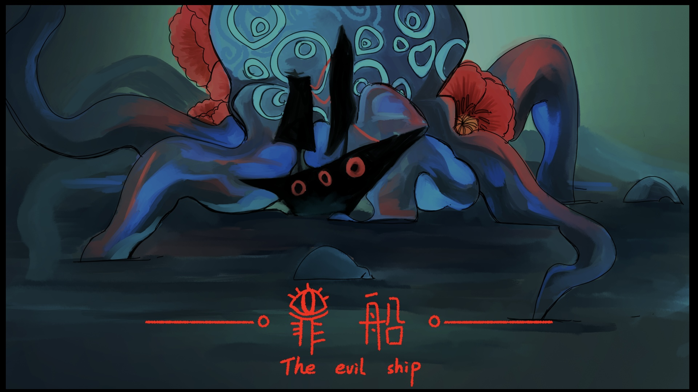

# 祁木良 · 作品集

**独立游戏制作人｜乌络游戏 Utoecho Games**

游戏 / 小说 / 剧本 / 影视 / 约稿音乐 / 策划案

[GitHub 主页](https://github.com/Brambleaaaaaa) · [个人简历](./resume/README.md) · [Vibe Coding](https://github.com/Brambleaaaaaa/vibecoding) · [AI 漫剧](https://github.com/Brambleaaaaaa/ai-manju)

---

## 总纲

| 栏目 | 内容 |
|---|---|
| [个人简历](./resume/README.md) | 游戏策划 / AI 漫剧 / 工作与教育经历 |
| [独立游戏](#独立游戏) | 视觉小说、叙事冒险、Game Jam、玩法原型 |
| [小说与写作](#小说与写作) | 短篇、散文、歌词、同人与练习稿 |
| [剧本](#剧本) | 游戏剧本、AI 短片剧本、跑团剧本 |
| [影视与 AI 漫剧](#影视与-ai-漫剧) | AI 漫剧管线、游戏影像、剪辑 |
| [音乐](#音乐) | 约稿配乐、原创歌曲与收藏曲目 |
| [策划案](#策划案) | 云汐、他曾执意如此、罪船 |

---

## 个人简历

**游戏策划 / AI 漫剧制作 / 文职类** · 期望城市：上海 · 工作时长：1 年

- 四次 Game Jam 完整项目开发经验，负责策划全流程并担任团队协调者
- 作为制作人主导 Galgame Demo 上线 Steam，全流程参与剧本、美术与界面
- 精通 AI 漫剧全流程：ComfyUI + Krea2 + Blender + LibTV
- 番茄小说签约作者；B 站 698 粉丝，游戏愿望单累计 1700+
- 独立开发多语言学习软件，接入 AI API 并提供翻译与学习辅助

→ [查看完整个人简历](./resume/README.md)

## 独立游戏

| 作品 | 类型 | 状态 | 入口 |
|---|---|---|---|
| [世界终焉之时 Endfaryth](./games/endfaryth) | 剧情向视觉小说 / JRPG | Steam Demo | [Steam](https://store.steampowered.com/app/5111560/) |
| [罪船 The Evil Ship](./games/evil-ship) | 叙事冒险 / 文字 AVG | Demo | [项目页](./games/evil-ship) |
| [已离开工位](./games/left-the-desk) | 动作 / Game Jam | 已上线 | [TapTap](https://tap.cn/lDNloJuU9) |
| [Correct Error](./games/correct-error) | 反乌托邦 / 剧情 / 恐怖 | 已上线（9.1） | [TapTap](https://tap.cn/lrdmk1ZrY) |
| [通胀螺旋](./games/inflation-spiral) | 经济机制原型（Unity） | 原型 | 见项目页 |
| [货币牌](./games/currency-cards) | 卡牌设计原型 | 设计稿 | 见项目页 |
| [云汐](./games/yunxi) | 2D 平台跳跃 / 解谜 | 策划中 | 见项目页 |

<table>
<tr>
<td></td>
<td></td>
</tr>
<tr>
<td align="center">世界终焉之时 · Endfaryth</td>
<td align="center">罪船 · The Evil Ship</td>
</tr>
</table>

## 小说与写作

| 作品 | 形式 | 说明 |
|---|---|---|
| [01 小乌龟](./novels/01_小乌龟.docx) | 短篇 | 约 4,600 字，第一人称返乡叙事 |
| [03 练笔 02](./novels/03_练笔02.docx) | 中篇练笔 | 约 11,700 字，架空反乌托邦 |
| [04 Never for leave](./novels/04_Never-for-leave_歌词.docx) | 歌词 | 中英对照，含编曲提示 |
| [05 时间怎么会等人呢，等你的人是我](./novels/05_时间怎么会等人呢_等你的人是我.docx) | 短篇 | 约 3,300 字，#人外 #科幻 #无性向 #时间 |
| [06 仰头的男人](./novels/06_仰头的男人.docx) | 短篇 | 约 6,500 字 |
| [07 爱人被寄生，弹幕却说我是虐文男配](./novels/07_爱人被寄生_弹幕却说我是虐文男配.docx) | 短篇 | 约 16,200 字，番茄小说已签约 · [番茄数据](./novels/assets/爱人被寄生_番茄数据_20261124.jpg) |
| [08 Pxcert](./novels/08_Pxcert_人外养成草案.md) | AVG 草案 | 约 1,450 字，人外养成，含序章与选择分支 |
| [09 枫叶南浔](./novels/09_枫叶南浔.md) | 微小说 | 约 4,800 字，高中旧作 |
| [10 间隙杂谈](./novels/10_间隙杂谈.md) | 散文 | 约 3,100 字 |
| [11 心界行者](./novels/11_心界行者_剧本废稿.md) | RPG 剧本废稿 | 约 7,900 字，未完成，从第二章起 |
| [12 秋日余烬](./novels/12_秋日余烬.md) | 随笔 | 约 2,100 字，2023-11-05 |
| [13 饿殍 · 同人练笔](./novels/13_饿殍_同人练笔.md) | 同人 / 练笔 | 约 2,600 字，《饿殍》同人，未完成 |
| [14 给朋友的 OC · 无偿练习稿](./novels/14_给朋友的OC_无偿练习稿.md) | 短篇练习 | 约 1,500 字，原创角色 |
| [15 保科 · 梦女向稿件](./novels/15_保科的梦女向稿件.md) | 梦女向 | 约 2,300 字，为朋友定制的无偿稿件 |
| [16 公孙瓒 × 刘备 · BL 同人](./novels/16_公孙瓒x刘备_BL同人稿.md) | 同人 | 约 2,500 字，三国历史向 |
| [17 克系意识流 · 超短篇练习](./novels/17_克系意识流_超短篇练习.md) | 超短篇 | 约 1,900 字，克苏鲁氛围 |
| [18 一首叙事诗](./novels/18_一首叙事诗.md) | 叙事诗 | 约 930 字，冬季意象 |

→ [进入小说与写作栏目](./novels/README.md)

## 剧本

| 作品 | 类型 | 文件 |
|---|---|---|
| 世界终焉之时 · 主线剧本 | 游戏剧本 | [docx](./screenplays/01_世界终焉之时_主线剧本.docx) |
| 雪烬 | 游戏剧本 | [docx](./screenplays/02_雪烬_剧本.docx) |
| 罪船 | 游戏剧本 | [docx](./screenplays/03_罪船_剧本.docx) |
| 死河（个人 AI 电影作品 01） | AI 短片剧本 | [md](./screenplays/04_死河_原创美恐剧本.md) |
| 跑团剧本 | 桌面跑团 | [试稿](./screenplays/跑团_试稿.md) |

## 影视与 AI 漫剧

- **AI 漫剧生产管线**：ComfyUI + Krea2，从角色资产到 Seedance 成片，26 个工作流已在 [ai-manju](https://github.com/Brambleaaaaaa/ai-manju) 开源。
- **视频作品与剪辑**：见 [B 站主页](https://b23.tv/x1DKl5q) 与 [videos 说明](./videos)。
- **游戏影像**：见各游戏项目页。

## 音乐

- 游戏、短片与个人项目的**约稿配乐**，含《Correct Error》《世界终焉之时》相关曲目。
- 原创歌曲 **《逢》（Rendezvous）**：由本人制作并发行，负责作词。
- 全部曲目、时长与音频文件：[music](./music)

### 收藏曲目

| # | 曲目 | 时长 | 试听 |
|---|---|---|---|
| 01 | Epiphany（立体声版本） | 1:21 | [MP3](https://github.com/Brambleaaaaaa/portfolio/releases/download/music-v2/01_epiphany.mp3) |
| 02 | Evo | 2:02 | [MP3](https://github.com/Brambleaaaaaa/portfolio/releases/download/music-v2/02_evo.mp3) |
| 03 | Lion | 1:25 | [MP3](https://github.com/Brambleaaaaaa/portfolio/releases/download/music-v2/03_lion.mp3) |
| 04 | ørken | 2:02 | [MP3](https://github.com/Brambleaaaaaa/portfolio/releases/download/music-v2/04_orken.mp3) |
| 05 | Rime | 3:26 | [MP3](https://github.com/Brambleaaaaaa/portfolio/releases/download/music-v2/05_rime.mp3) |
| 06 | Voyage | 1:36 | [MP3](https://github.com/Brambleaaaaaa/portfolio/releases/download/music-v2/06_voyage.mp3) |
| 07 | 淬青 | 0:57 | [MP3](https://github.com/Brambleaaaaaa/portfolio/releases/download/music-v2/07_cuiqing.mp3) |
| 08 | 旌途 | 0:41 | [MP3](https://github.com/Brambleaaaaaa/portfolio/releases/download/music-v2/08_jingtu.mp3) |

全部文件托管在 [music-v2 Release](https://github.com/Brambleaaaaaa/portfolio/releases/tag/music-v2)。

## 策划案

| 项目 | 内容 | 文件 |
|---|---|---|
| 云汐 | 完整策划案 v0.1 | [md](./planning/01_云汐_策划案.md) |
| 云汐 | 官方世界观设定 v1 | [md](./planning/02_云汐_世界观设定.md) |
| 云汐 | 剧本创作规范 | [md](./planning/03_云汐_剧本创作规范.md) |
| 云汐 | 程序需求与配置规范 | [docx](./planning/04_云汐_程序需求与配置规范.docx) |
| 云汐 | 人物设定 / 怪物描述 / 支线 | [docx](./planning/05_云汐_人物设定.docx) · [docx](./planning/06_云汐_怪物描述.docx) · [docx](./planning/07_云汐_支线剧情.docx) |
| 他曾执意如此 | 完整策划案 | [pdf](./games/left-the-desk/design-doc.pdf) |
| 罪船 | 策划概述 / UI 布局 | [pdf](./games/evil-ship/design-overview.pdf) · [pdf](./games/evil-ship/ui-layout.pdf) |

## 社媒

| 平台 | 账号 | 链接 |
|---|---|---|
| TapTap（大号） | 已离开工位 / 乌络游戏 | https://tap.cn/lDNloJuU9 |
| TapTap（小号） | Correct Error | https://tap.cn/lrdmk1ZrY |
| 小黑盒 | 个人主页 | https://www.xiaoheihe.cn/bbs/user_profile_share?user_id=aa6369f22201&h_src=heyboxapp |
| 小黑盒 | 世界终焉之时 | https://api.xiaoheihe.cn/game/share_game_detail?appid=3e1b69c30644&game_type=pc&h_camp=game&h_src=YXBwX3NoYXJl |
| B 站 | 乌络游戏-祁木良 | https://b23.tv/x1DKl5q |
| 抖音 | 个人随笔（抖音号 61113198594） | https://www.douyin.com/search/61113198594?type=user |
| 抖音 | 工作室宣传（抖音号 61690686111） | https://www.douyin.com/search/61690686111?type=user |
| 抖音 | AI 漫剧号 | 建设中 |
| Steam | Endfaryth Demo | https://store.steampowered.com/app/5111560/ |

---

本仓库仅收录本人原创作品与公开资料；商业合同、个人信息与未公开内容不在收录范围内。

&nbsp;&nbsp;&nbsp;&nbsp;

