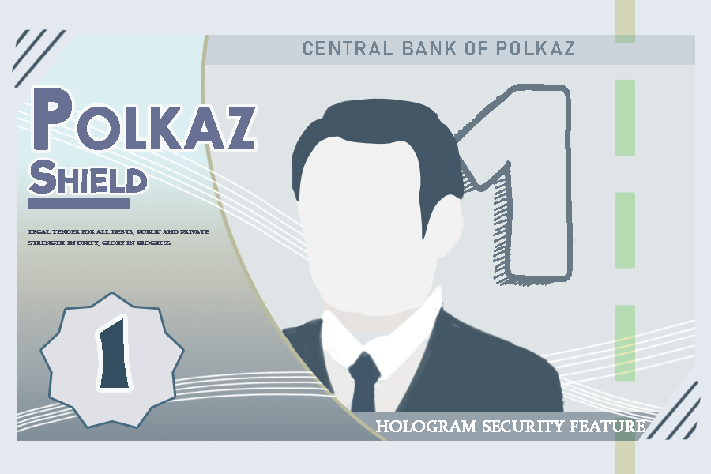
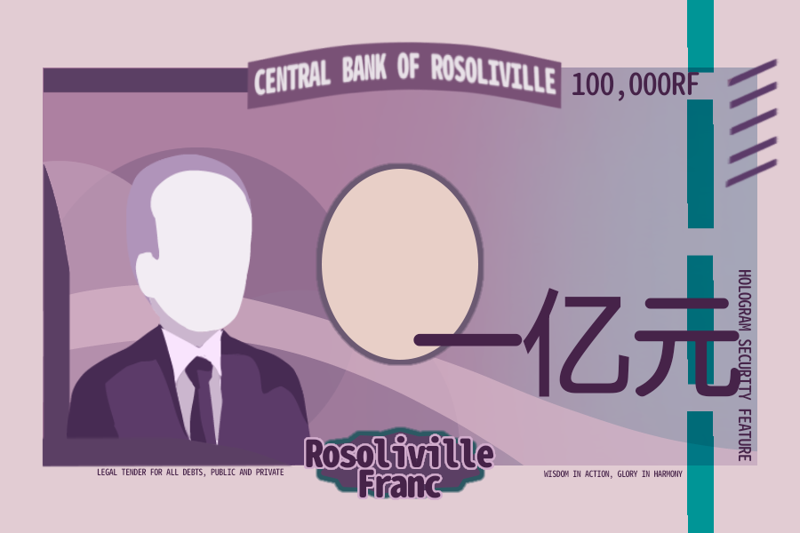
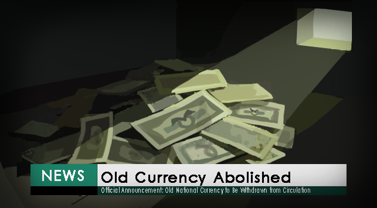

# 货币牌

> 卡牌设计原型 ｜ 面额 1 → 100,000,000

为《通胀螺旋》世界设计的货币卡牌体系，四个阵营各自拥有一套面额从 1 到 100,000,000 的卡面，另有通货膨胀、政权更迭、旧币作废等随机事件卡。

## 卡面样例

| 卡罗维尔 100 | 波尔卡兹 1 |
|---|---|
|  |  |

| 罗索里维尔 100,000,000 | 事件：旧币作废 |
|---|---|
|  |  |

## 设计说明

- 四个阵营：卡罗维尔、波尔卡兹、罗索里维尔、门什。
- 面额跨度大，用于表现恶性通胀下的数值失控。
- 卡面统一版式，便于后续扩展与印刷测试。

## 素材

完整卡面素材包见 [Releases](https://github.com/Brambleaaaaaa/portfolio/releases/tag/currency-cards)。

---

[← 返回游戏列表](../README.md)
