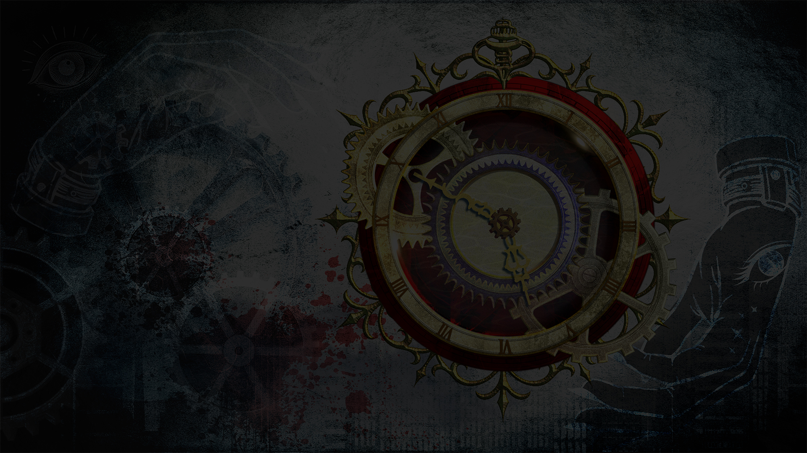
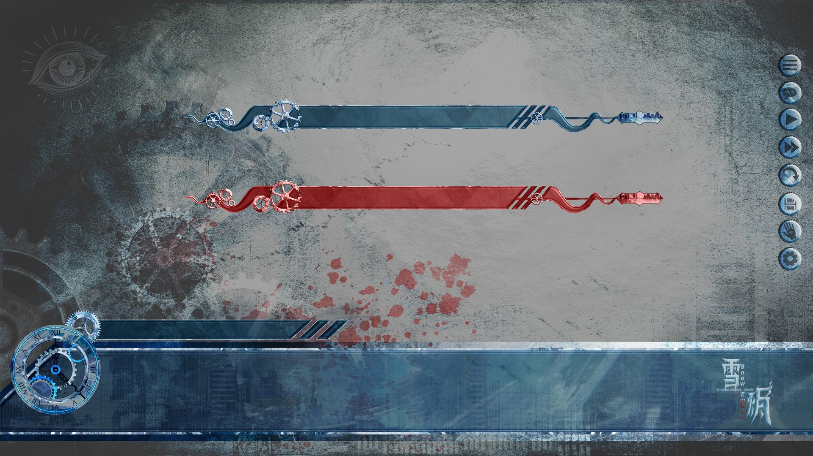

# 世界终焉之时 · Endfaryth

> Steam Demo ｜ 剧情向视觉小说 / JRPG ｜ 蒸汽朋克 · 末世 · 多结局

**5135 年，一种名为“灰烬”的物质污染了天空，无尽的暴雪吞噬了世界。你从黑暗中醒来，对自己的过去毫无记忆。面对脆弱的温暖，你会忘记过去、抓住当下，还是走进冰原，寻找自己究竟是谁？**

- Steam：[Endfaryth Demo](https://store.steampowered.com/app/5111560/)
- 小黑盒：[游戏页](https://api.xiaoheihe.cn/game/share_game_detail?appid=3e1b69c30644&game_type=pc&h_camp=game&h_src=YXBwX3NoYXJl)
- 发行：乌络游戏（Utoecho Games）｜ 2026-08-23

## 标签

Visual Novel · JRPG · Interactive Fiction · Steampunk · Post-apocalyptic · Multiple Endings · Story Rich · First-Person

## 截图

| 主菜单 | 对话界面 |
|---|---|
|  |  |

## 制作

- 引擎：Ren'Py
- 叙事：第一人称、多结局、分支对话
- 工作流：剧本 → 分镜 → 角色/场景资产 → 立绘与 CG → 配音 → 打包
- 剧本全文：[世界终焉之时 · 主线剧本](../../screenplays/01_世界终焉之时_主线剧本.docx)

## 下载

Windows Demo 包体见 [Releases](https://github.com/Brambleaaaaaa/portfolio/releases/tag/endfaryth-demo)。

---

[← 返回游戏列表](../README.md)
