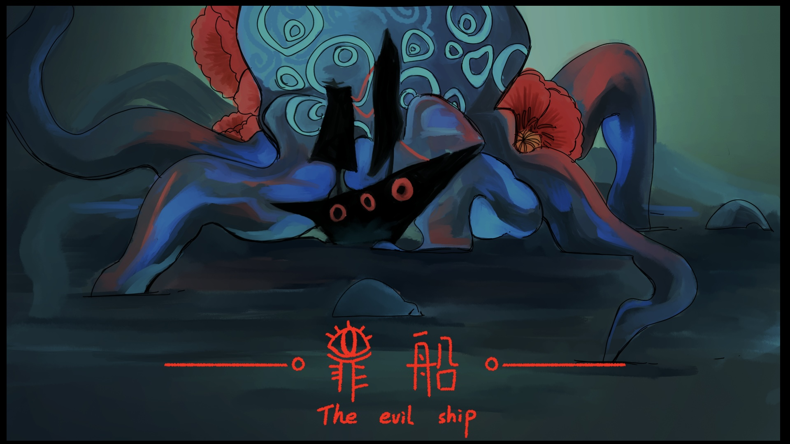
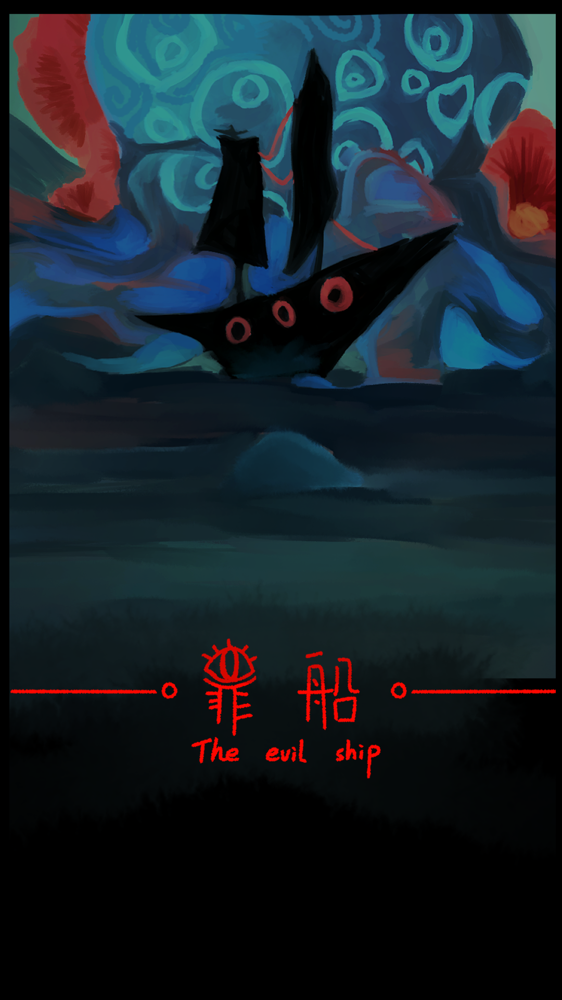

# 罪船 · The Evil Ship

> 叙事冒险 ｜ 文字 AVG ｜ 雾海 · 罪孽 · 抉择

在霍尔小镇，犯下罪孽却无法得到神明宽恕的人，会被送上“罪船”，驶向被迷雾吞没的深海。玩家扮演船长，与轮机长、厨师、水手长、大副和一位奸商同船，在航程中做出一连串决定。

- 平台：PC
- 类型：剧情向文字冒险 / 视觉小说
- 状态：Demo
- 剧本全文：[罪船 · 剧本](../../screenplays/03_罪船_剧本.docx)

## 宣传图

| 横版 | 竖版 |
|---|---|
|  |  |

## 设计文档

- [策划概述（手写版整理）](./design-overview.pdf)
- [UI 布局设计](./ui-layout.pdf)

## 制作

- 剧本采用“角色缩写 + 旁白 + 画面效果 + CG/BG”的表格化写法，方便直接导入引擎。
- 主要角色：汤姆·克里索（轮机长）、菲尔温（厨师）、威尔（水手长）、罗南（大副）、拉克斯帕（奸商）、玩家（船长）。
- 美术：宣传图、CG、场景与 UI 分离管理。

## 下载

Windows Demo 包体见 [Releases](https://github.com/Brambleaaaaaa/portfolio/releases/tag/evil-ship-demo)。

---

[← 返回游戏列表](../README.md)
