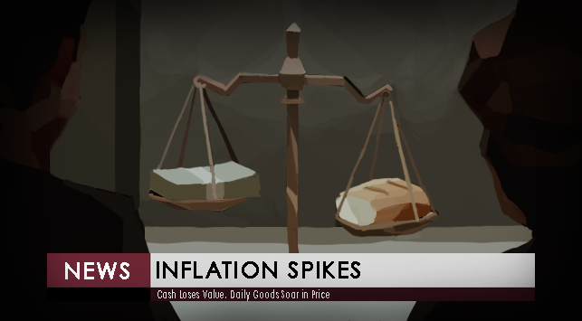
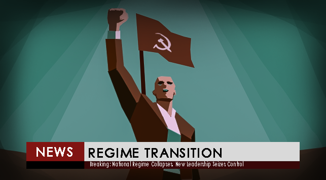
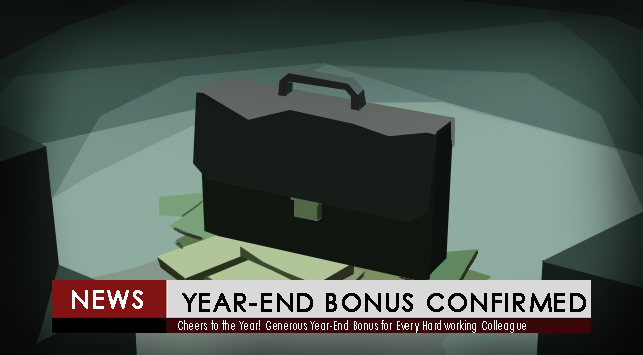
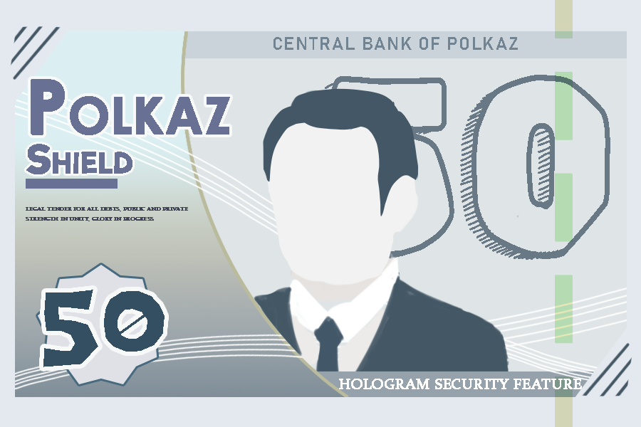
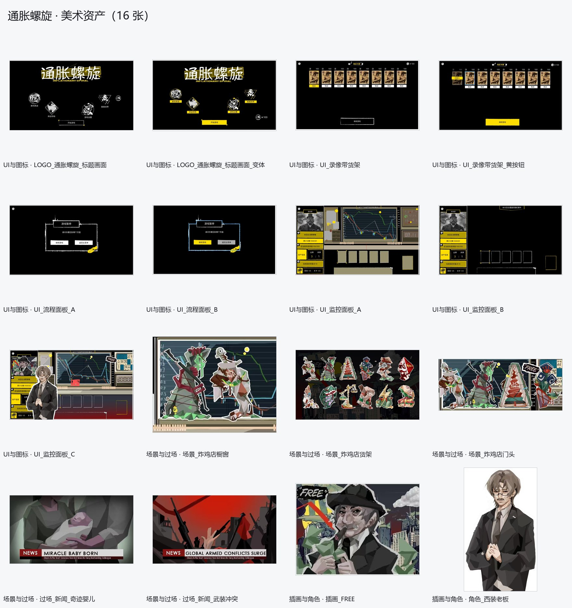
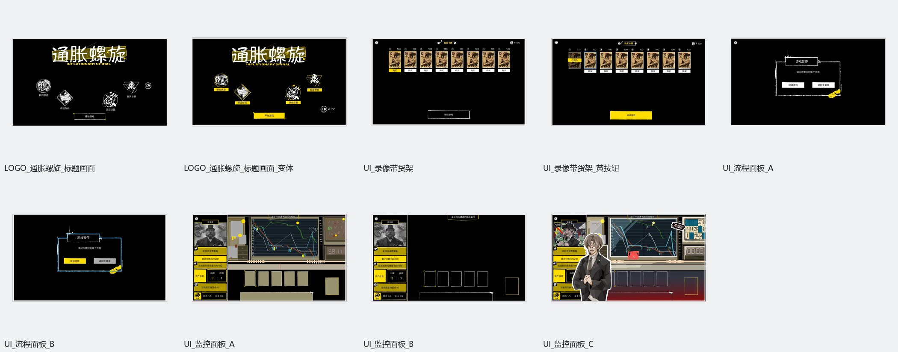
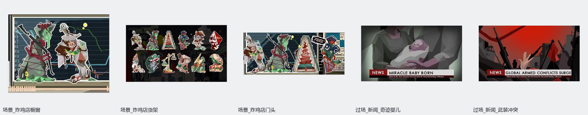
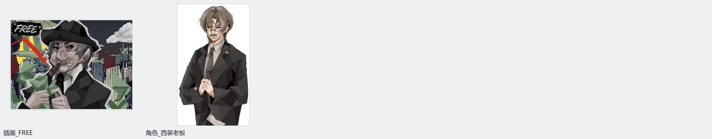

# 通胀螺旋

> 经济题材策略原型 ｜ Unity

一个以通货膨胀为核心机制的策略原型。四个阵营——卡罗维尔、波尔卡兹、罗索里维尔、门什——拥有各自的面额体系；随机事件会直接改写场上的经济规则。

## 机制

- **面额体系**：同一阵营的货币从 1 到 100,000,000 分级，面额本身就是资源与风险。
- **随机事件**：通货膨胀、政权更迭、优化风险、旧币作废、黑夜之潮等事件会打断既定策略。
- **阵营差异**：不同阵营的货币设计、数值曲线与事件响应不同。

## 截图

| 通货膨胀 | 政权更迭 |
|---|---|
|  |  |

| 优化风险 | 角色 |
|---|---|
|  |  |

## 美术资产

原型期间产出的界面、场景与插画资产，共 **16 张**。点击预览图可进入对应目录查看原图；完整清单见 [manifest.json](./art-assets/manifest.json)。

| UI 与图标（9） | 场景与过场（5） |
|---|---|
|  |  |
| 标题画面与 Logo、监控面板、流程面板、录像带货架 | 炸鸡店橱窗、货架、门头与新闻过场 |

### 插画与角色（2）

西装老板立绘与 FREE 拼贴插画。

## 工程说明

- 引擎：Unity
- 版本管理：Git + Unity 协作规范（见项目内文档）
- 状态：v1.0 原型

## 下载

Windows 原型包见 [Releases](https://github.com/Brambleaaaaaa/portfolio/releases/tag/inflation-spiral-demo)。

---

[← 返回游戏列表](../README.md)

