# 已离开工位

> 动作 ｜ TapTap 聚光灯 Game Jam ｜ 2026-10-21

“每天熬夜加完班之后第二天还要挤地铁……终于下定决心肘飞老板，迎来自己新的人生。”

- TapTap：[已离开工位](https://tap.cn/lDNloJuU9)（10.0 分）
- 开发：乌络游戏
- 赛事：TapTap 聚光灯 Game Jam

## 相关设计案

《他曾执意如此》是同一阶段完成的完整策划案：玩家扮演一名长期失眠的社畜黎恩，在服药后出现幻觉，幻觉中的小游戏行为会反过来影响现实。世界观设定在架空冷战时期，核心是“幻想涌现”与“恐惧涌现”。

- [《他曾执意如此》策划案（PDF）](./design-doc.pdf)

## 策划与美术需求（节选）

Jam 期间的分关策划、动作清单与场景草图：

| 第二关 · 美术需求 | 第四关 · 加班 Boss 流程 |
|---|---|
|  |  |

| 主角与老板 · 动作设定 | 动作清单 |
|---|---|
| [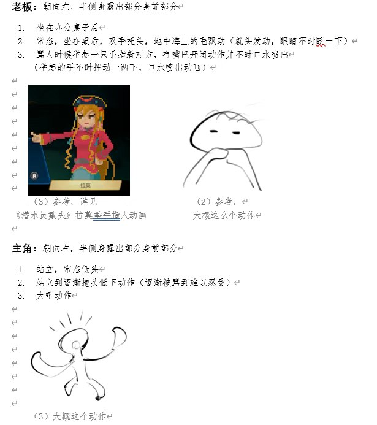](./planning/03_主角与老板_动作设定.jpg) | [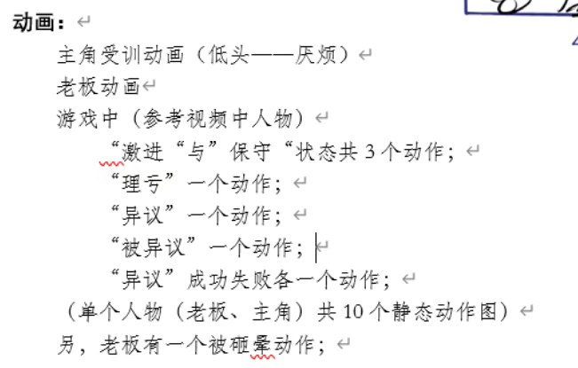](./planning/04_动作清单.jpg) |

| 第四关 · 老板动作草图 | 第二关 · 工位场景草图 | 文件与部门 · UI 草图 |
|---|---|---|
| [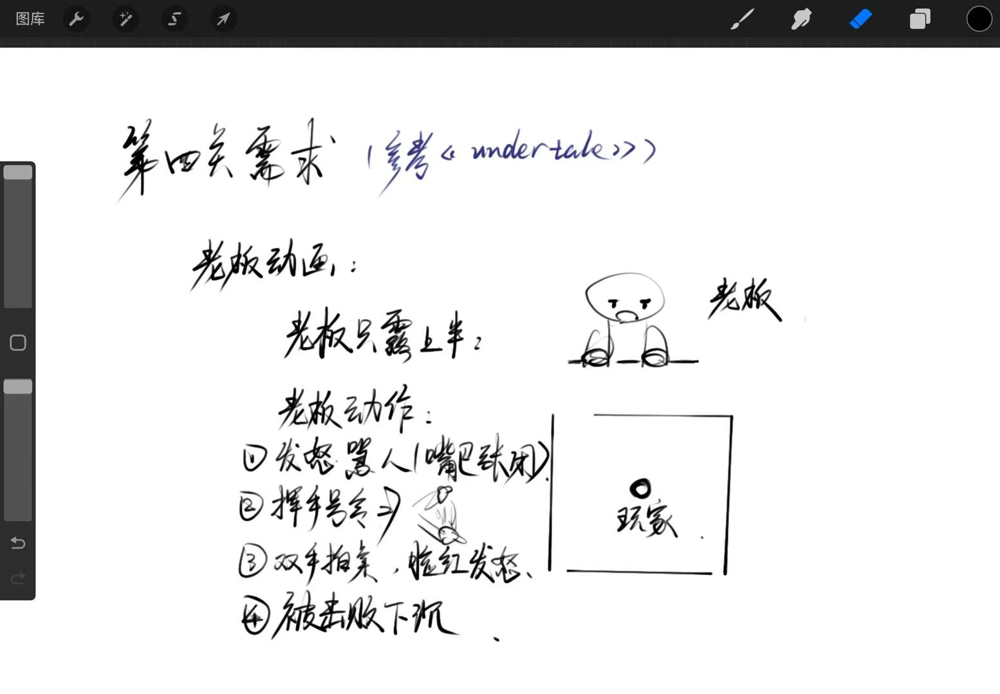](./planning/05_第四关_老板动作草图.jpg) |  |  |

### 策划草案

- [音效、音乐需求与过渡文案](./planning/08_策划草案_音效音乐与文案.md)：主界面、街道、节奏游戏、第二至四关的音效清单，BGM 选曲，以及垃圾话与工作卡文案。
- [文案部分](./planning/09_策划草案_文案部分.md)：与上一份内容一致，保留原始文件。

## 美术资产

Jam 期间产出的角色立绘、UI、场景、特效与概念图，共 **111 张**（已去除 2 张完全重复文件），按类型分目录存放。点击预览图可进入对应目录查看原图；完整清单见 [manifest.json](./art-assets/manifest.json)。

### 角色立绘（36）

[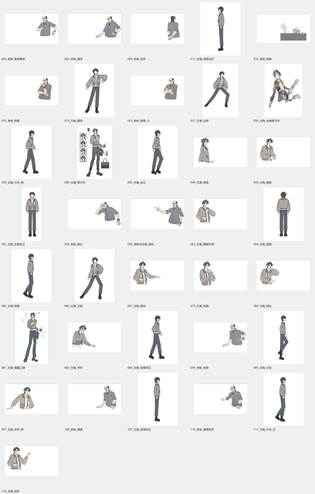](./art-assets/角色立绘/)

主角与老板的站姿、行走、指向、蹲姿、整理衣领等动作差分，含西装版老板肖像。

### UI 与图标（14）

[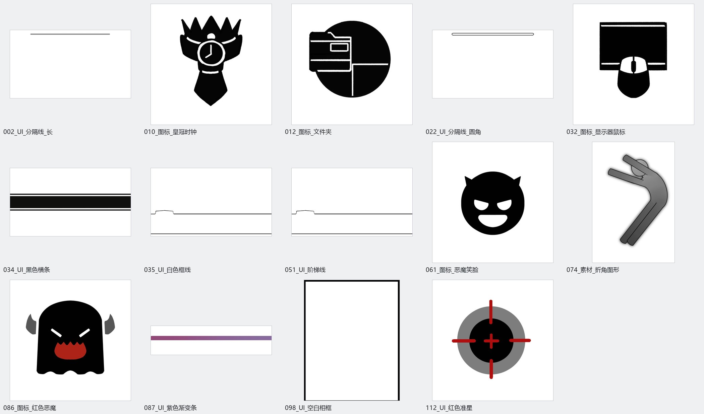](./art-assets/UI与图标/)

皇冠时钟、文件夹、监控面板、流程面板、红色准星与分隔线等界面元素。

### 粒子与素材（28）

[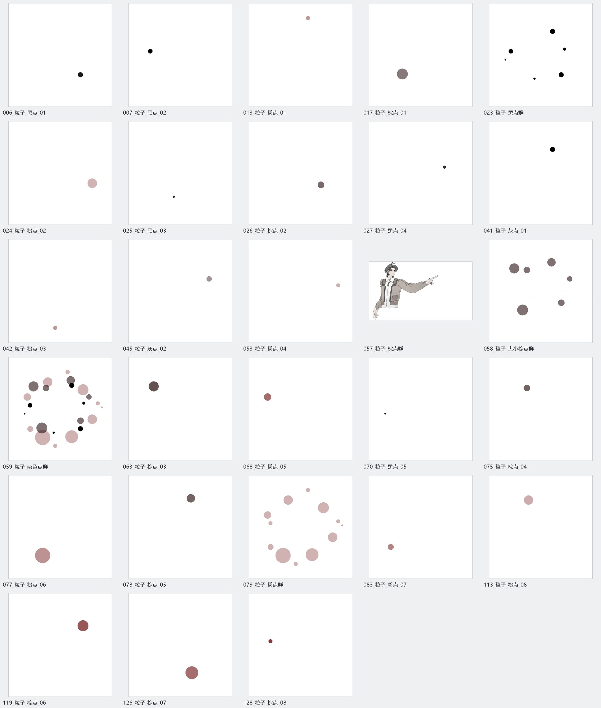](./art-assets/粒子与素材/)

黑、灰、棕、粉四组圆点粒子及点群，用于转场与氛围叠加。

| 头像与表情（8） | 场景与背景（9） |
|---|---|
| [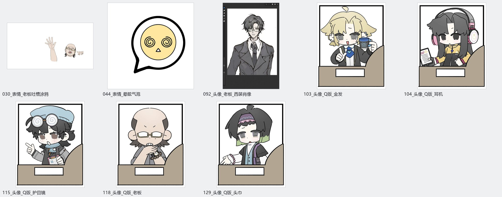](./art-assets/头像与表情/) | [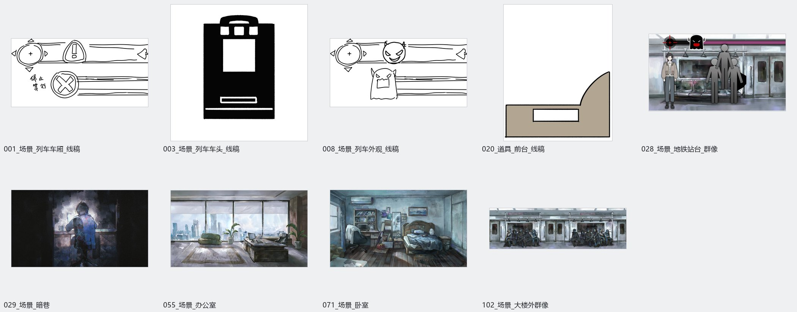](./art-assets/场景与背景/) |
| 主角与老板的 Q 版头像、西装肖像与晕眩表情气泡 | 办公室、卧室、地铁站台与车厢线稿等场景 |

| 特效（3） | 漫画分镜（3） |
|---|---|
| [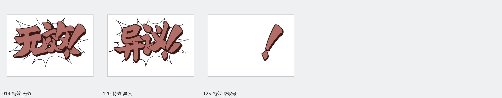](./art-assets/特效/) | [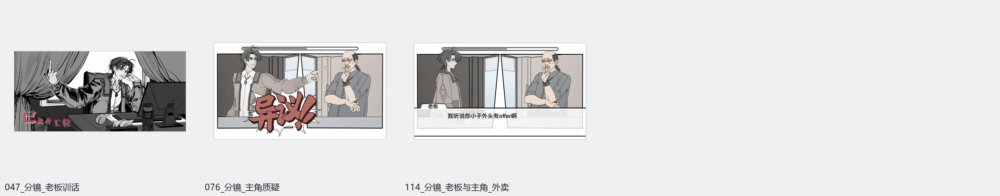](./art-assets/漫画分镜/) |
| “无效！”“异议！”与感叹号漫画字效 | 老板训话、主角质疑与“外卖”对话分镜 |

| 概念插画（5） | 设定参考（5） |
|---|---|
| [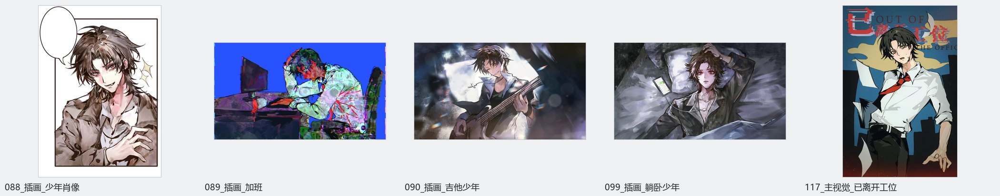](./art-assets/概念插画/) | [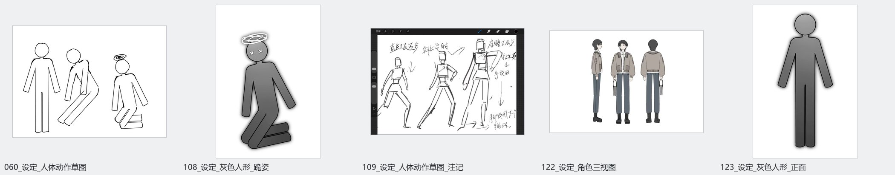](./art-assets/设定参考/) |
| 主视觉“已离开工位”与情绪插画 | 人体动作草图、角色三视图与灰色人形参考 |

## 下载

Windows 包体见 [Releases](https://github.com/Brambleaaaaaa/portfolio/releases/tag/left-the-desk-demo)。

---

[← 返回游戏列表](../README.md)
