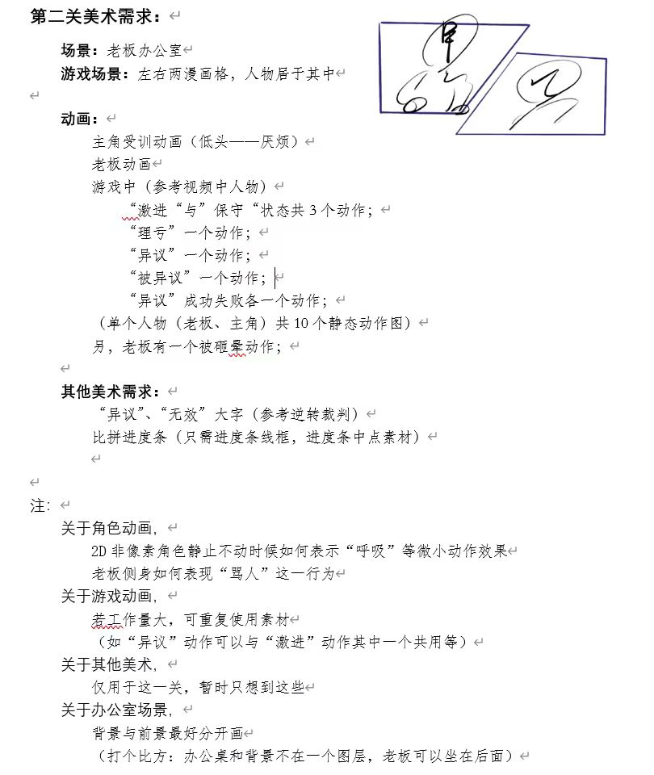
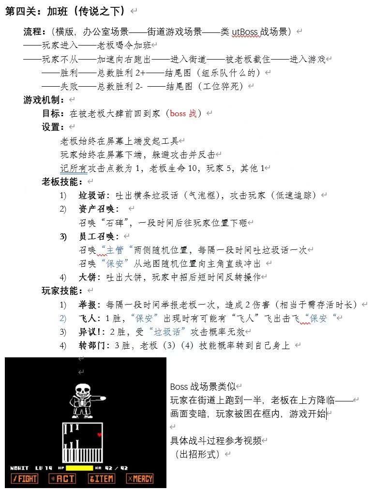
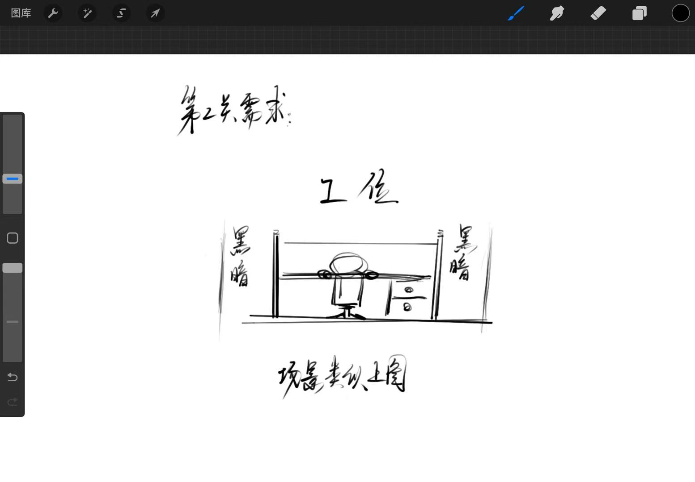
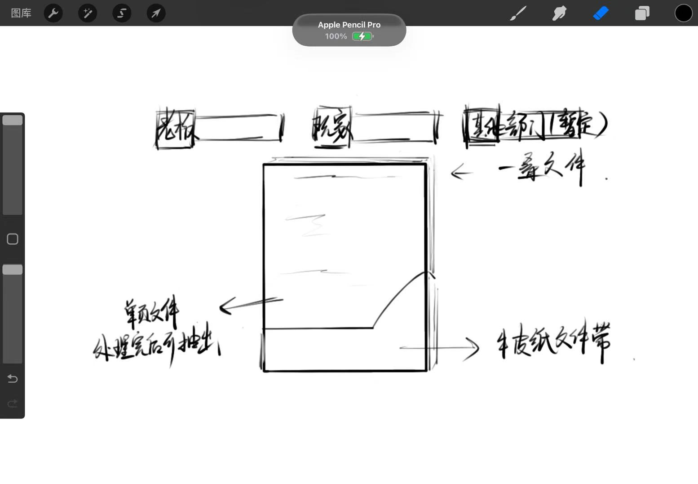

# 已离开工位

> 动作 ｜ TapTap 聚光灯 Game Jam ｜ 2026-10-21

“每天熬夜加完班之后第二天还要挤地铁……终于下定决心肘飞老板，迎来自己新的人生。”

- TapTap：[已离开工位](https://tap.cn/lDNloJuU9)（10.0 分）
- 开发：乌络游戏
- 赛事：TapTap 聚光灯 Game Jam

## 相关设计案

《他曾执意如此》是同一阶段完成的完整策划案：玩家扮演一名长期失眠的社畜黎恩，在服药后出现幻觉，幻觉中的小游戏行为会反过来影响现实。世界观设定在架空冷战时期，核心是“幻想涌现”与“恐惧涌现”。

- [《他曾执意如此》策划案（PDF）](./design-doc.pdf)

## 策划与美术需求（节选）

Jam 期间的分关策划、动作清单与场景草图：

| 第二关 · 美术需求 | 第四关 · 加班 Boss 流程 |
|---|---|
|  |  |

| 主角与老板 · 动作设定 | 动作清单 |
|---|---|
|  |  |

| 第四关 · 老板动作草图 | 第二关 · 工位场景草图 | 文件与部门 · UI 草图 |
|---|---|---|
|  |  |  |

### 策划草案

- [音效、音乐需求与过渡文案](./planning/08_策划草案_音效音乐与文案.md)：主界面、街道、节奏游戏、第二至四关的音效清单，BGM 选曲，以及垃圾话与工作卡文案。
- [文案部分](./planning/09_策划草案_文案部分.md)：与上一份内容一致，保留原始文件。

## 下载

Windows 包体见 [Releases](https://github.com/Brambleaaaaaa/portfolio/releases/tag/left-the-desk-demo)。

---

[← 返回游戏列表](../README.md)
