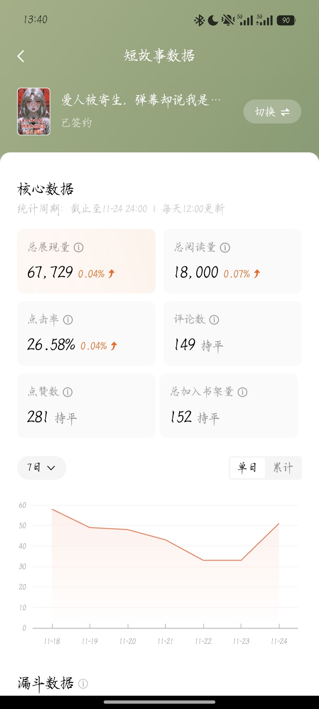
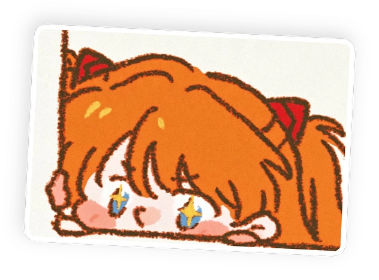
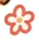

# 小说与写作

原创短篇、散文、随笔、练笔与同人练习。Word 文件保留原格式，Markdown 可直接在线阅读。

## 原创与练笔

| # | 作品 | 形式 | 体量 |
|---|---|---|---|
| 01 | [小乌龟](./01_小乌龟.docx) | 短篇 | 约 4,600 字，第一人称返乡叙事 |
| 03 | [练笔 02](./03_练笔02.docx) | 中篇练笔 | 约 11,700 字，架空反乌托邦 |
| 04 | [Never for leave](./04_Never-for-leave_歌词.docx) | 歌词 | 中英对照，附编曲与情绪提示 |
| 05 | [时间怎么会等人呢，等你的人是我](./05_时间怎么会等人呢_等你的人是我.docx) | 短篇 | 约 3,300 字，#人外 #科幻 #无性向 #时间 |
| 06 | [仰头的男人](./06_仰头的男人.docx) | 短篇 | 约 6,500 字 |
| 07 | [爱人被寄生，弹幕却说我是虐文男配](./07_爱人被寄生_弹幕却说我是虐文男配.docx) | 短篇 | 约 16,200 字，番茄小说已签约 |
| 08 | [Pxcert](./08_Pxcert_人外养成草案.md) | AVG 草案 / 灵感集 | 约 1,450 字，人外养成，含序章与选择分支 |
| 09 | [枫叶南浔](./09_枫叶南浔.md) | 微小说 | 约 4,800 字，高中旧作 |
| 10 | [间隙杂谈](./10_间隙杂谈.md) | 散文 | 约 3,100 字 |
| 11 | [心界行者](./11_心界行者_剧本废稿.md) | RPG 剧本废稿 | 约 7,900 字，未完成，从第二章起 |
| 12 | [秋日余烬](./12_秋日余烬.md) | 随笔 | 约 2,100 字，2023-11-05 |

## 同人与练习稿

| # | 作品 | 形式 | 体量 |
|---|---|---|---|
| 13 | [饿殍 · 同人练笔](./13_饿殍_同人练笔.md) | 同人 / 练笔 | 约 2,600 字，《饿殍》同人，未完成 |
| 14 | [给朋友的 OC · 无偿练习稿](./14_给朋友的OC_无偿练习稿.md) | 短篇练习 | 约 1,500 字，原创角色 |
| 15 | [保科 · 梦女向稿件](./15_保科的梦女向稿件.md) | 梦女向 | 约 2,300 字，为朋友定制的无偿稿件 |
| 16 | [公孙瓒 × 刘备 · BL 同人](./16_公孙瓒x刘备_BL同人稿.md) | 同人 | 约 2,500 字，三国历史向 |
| 17 | [克系意识流 · 超短篇练习](./17_克系意识流_超短篇练习.md) | 超短篇 | 约 1,900 字，克苏鲁氛围 |
| 18 | [一首叙事诗](./18_一首叙事诗.md) | 叙事诗 | 约 930 字，冬季意象 |

> 本栏为同人与无偿练习稿，仅作写作练习与存档；相关原作版权归原作者所有，不作商业用途。

## 爱人被寄生 · 番茄数据

《爱人被寄生，弹幕却说我是虐文男配》在番茄小说的后台数据（截至 2026-11-24 24:00）：

| 指标 | 数值 |
|---|---|
| 总展现量 | 67,729 |
| 总阅读量 | 18,000 |
| 点击率 | 26.58% |
| 评论数 | 149 |
| 点赞数 | 281 |
| 总加入书架量 | 152 |

[查看原图](./assets/爱人被寄生_番茄数据_20261124.jpg)

## 说明

- 作品均为原创（同人栏目除外），转载请注明作者。
- 部分文本为早期练笔，保留原始版本，不做二次润色。

---

[← 返回作品集](../README.md)

&nbsp;&nbsp;&nbsp;&nbsp;

