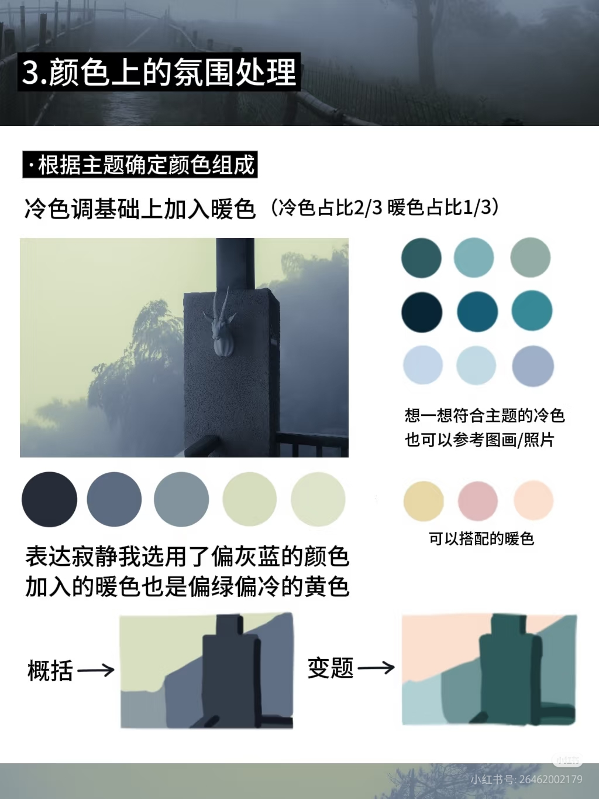
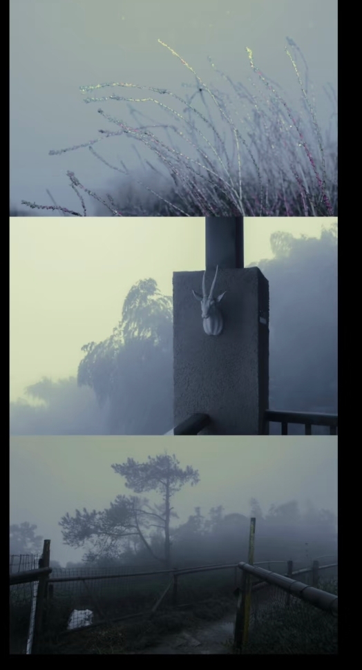
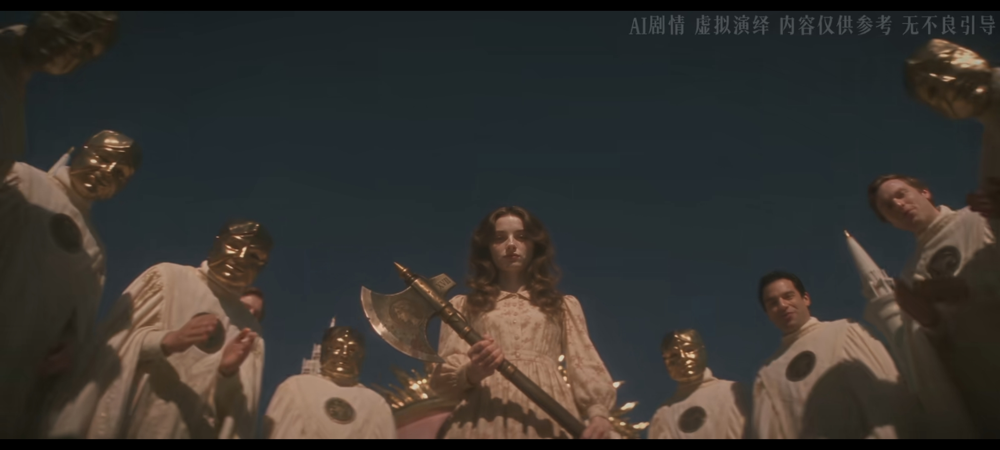
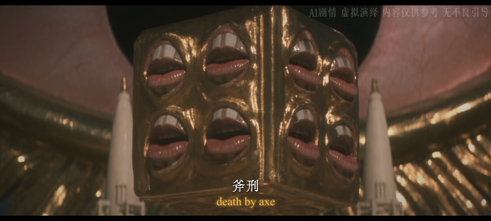
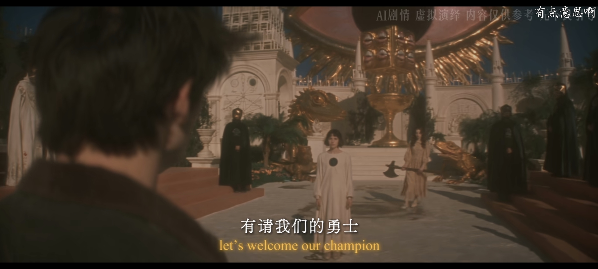
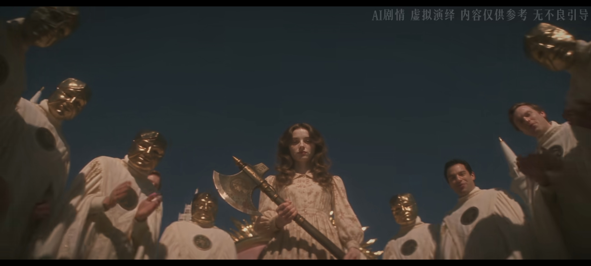
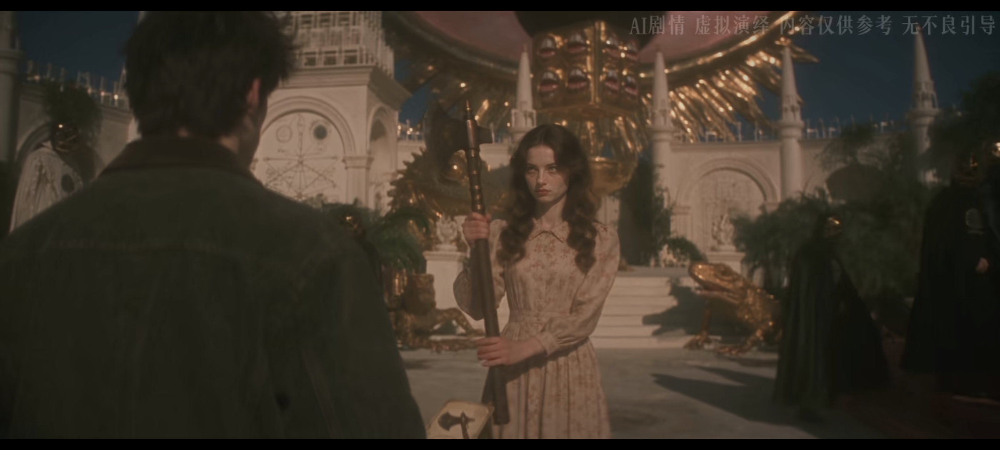
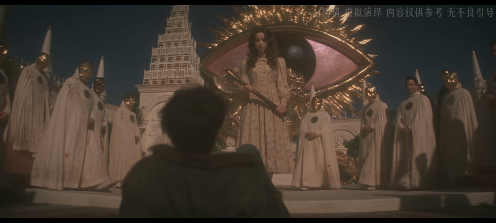
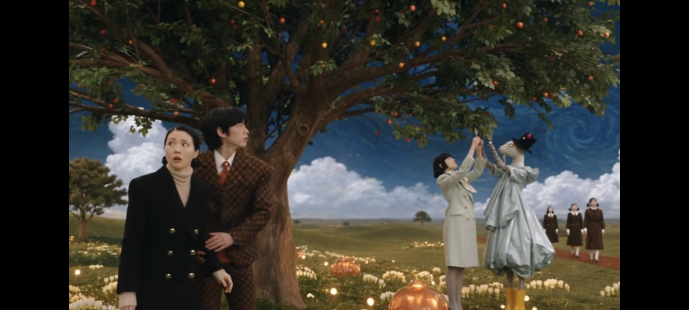
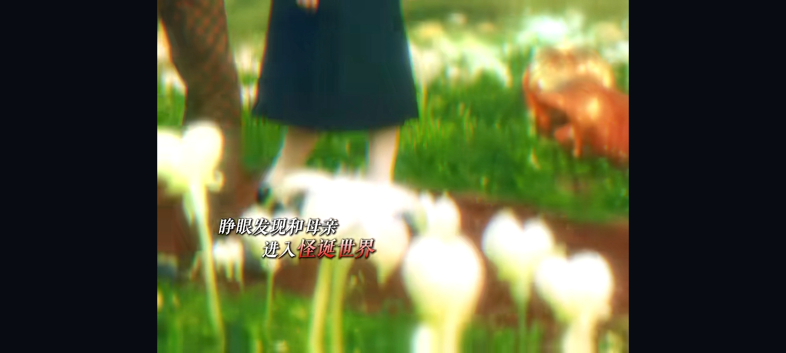

# 祁木良个人AI电影作品1：《死河》——原创短篇美恐剧本

#                                         《死河》

​                       ***——生人在死去，河流永不停歇，我们都是死者。***

#  目录

一.一句话简介+电影美术风格

1.一个找忧郁男nerd找好朋友但被死河巡逻者追杀，最终成功救出好朋友，但永远失去了爱人的短篇cult片。

2.美术风格：贴合cult片《河》，恐怖片《痴迷》的色调，超写实电影质感的ai真人剧。拥有写实的场景和独特的氛围，调色盘会用到的为四种，我按照序号放在下面了：1.在追逐，逃亡，反位世界，压抑情节的时候使用温子仁的八种鬼光进行调色和打光，严格按照：调色盘，质感，打光，摄像机运镜这四种格式来写此处的提示词。

上图为1的调色参考。

可参考希区柯克的电影调色风格。

2.在开头派对的温馨和狂欢情节以及结尾成功逃离和彼此释怀的情节为暖色调，温馨日常的配色，可参考如下：

3.梦境中用蓝色，墨绿色，部分红色为主氛围，此处情节主打一个快切杂乱：

4.在短暂的梦核场景中，可参考下列图片的配色，需要你反推提示词，比如摄像机，调色，打光和运镜等，可参考的作品有ai影视作品阳光补习班，雾隐镇：

 二.世界观：

1.死河：彼岸和表岸的分界河流，一条贯穿死亡与现实的河流，在通常情况下它是不被世人所见的，但内心痛苦者或心有遗憾的人会在特定的地方通过特殊的手段跨入死河之中，据小镇遥远的传说可知当表岸之人跨过死河，来到彼岸，便可见到心中所想之人，或者完成心中的遗憾，改变过去。但心智不坚定者会永恒迷失在这条河流之中。

死河在不断扩张和侵染现实，它的目的便是吞没整个世界，来强大自己。

2.徘徊者：因为各种原因迷失在死河的活人，由于被巡逻者杀死的次数太多已经忘却了自己是谁，偶尔清晰时会给出几句关键的线索，至于如何清醒：则是在表岸（即现实世界中拿到他所熟悉的事物），死河贯穿整个世界，此故事发生在美国加州乡下的一个人迹寂寥的小镇中，所以每一位居民彼此都很熟识，所以这里的徘徊者可能是曾经的邻居，或者曾经失踪的人。注意，当活人彻底迷失在了死河中时，表岸的人，除了和此人熟络之人会逐渐把他遗忘，而就算熟络之人，随着时间的推进，也会逐渐忘却他，新进死河的人倘若拿着徘徊者迷失前在表岸的熟悉物件可让徘徊者强制清醒一次，否则便只能等他自己清醒。而进入死河的人在看到徘徊者时，哪怕在表岸已经将其遗忘，但也会瞬间回忆起有关此人的记忆，这个类似于一个记忆的专属触发点吧。

徘徊者一旦迷失在死河，巡逻者便会停止追杀，直到他再次清醒。徘徊者清醒的时候会吸引来巡逻者的追杀，每次被杀死徘徊者都会丢失一段记忆，除非他脱离死河，则会恢复所有记忆，否则只会逐渐迷失自我，被彻底同化，成为死河内反位世界的生物，直到寿命走到尽头，再跨过死河来到彼岸，成为真正的死者。

徘徊者每次死亡都会被死河送入“正常”的分支，类似于世界线的回束，尚未死亡的徘徊者会被送往时间一致的时间线，以确保唯一的“真实”，但彼此的经历都个不相同。会造成一种“进入溯洄或者轮回的错觉假象”，但每次被杀死后都会丢失一段记忆，直到彻底迷失。

徘徊者分为如下几类：

- 1.自愿进入寻找传说的人，或者带着目的想要前往反位世界的人：如主角几人。
- 2.误入者：此类人因为内心执念过深而吸引了死河的注视，被打上印记，牵引至死河。如诺伊和芮伊亚两人。

那么该如何脱离死河呢？只需要在巡逻者杀死一位徘徊者的时候，附近会短暂的出现通往表岸的裂缝，进入即可回去，而下次再进入只需要主动寻找裂缝即可。表岸的裂缝在不断形成，因为前面也说了，死河在不断侵染表岸。

3.巡逻者：（剧中形象为蒙面杀人狂）：死河边界的本地居民，生前是罪孽滔天之人，有连环杀人犯，也有恐怖电影的源头，总之是一切噩梦的源头。死后被死河同化，丢失了理智，唯一的目的就是不断杀死未被死河同化的徘徊者，以及替死河到处抓捕被死河打上印记的人。

4.反位世界的小镇居民们：已经被彻底同化的徘徊者，只保留着基础的本能和维持机体运转的理智：繁衍，进食以及维持生为人类的运转，这里也是一个小型社会，但是主要靠教会来负责维持运转，即梦核世界的剧情，实际上就是现实，但男主误认为自己是在做梦。

5.反位世界：死河内部的世界，被同化生物的居住地，这里的时间是错误的，过去，未来，现在同时存在，是一切噩梦具现之地，是一切罪恶之人的永恒束缚之地。因为这里的时间是错误的，所以死河可以轻易的操纵时间，以及收束世界线，让徘徊者不断死去而丢失记忆是必要的，但同时在他们死去之后，那条世界线便会被放弃，让他们以“重生”的形式重新聚集在一起，造成轮回的假象，收束世界线也是死河维持稳定的必要条件。 

6.表岸：

这是一个可扩展的世界观，本片人物在此中篇故事结束后便结束故事，但是可以根据此世界观扩充更多的故事。当然了也视情况而定，我会写一个开放式结局，看播放量再决定是否写续集，决定这批角色是否继续走下去，发展成长剧甚至是一个完整的恐怖宇宙。  

三.人物设定   

男主：赖恩：Laen

女主：芮伊亚：Rhea

男配1：费利克斯：felix

女配1：夏洛特：Charlotte

男配2：诺伊：noah

便利店店员：迈克：mike

巡逻者：杀人狂魔（反派）：

徘徊者：一个外貌约七十岁的无名男性老者。

人物关系：

男主和女主为情侣关系

若干群演：充当背景板。（排队场景）

四.剧本大纲

因为一次意外，赖恩在派对上亲眼目睹了芮伊亚失踪的全过程，回家失魂颠倒痛苦之时在梦中看到了失踪了一年的诺伊，为了不让悲剧重演，和自己的好友费利克斯以及芮伊亚的闺蜜夏洛特一起前往追寻莫须有的线索，从而被死河打上印记，进而在公路的迷雾当中来到表岸边境，进入小镇后一直被巡逻者追杀，但成功与芮伊亚会和，赖恩会经历一次奇怪地梦境（约半集左右），芮伊亚线会找到诺伊的线索，夏洛特和费利克斯会和徘徊者对话，在一位短暂清醒的徘徊者的指引下回到表岸找到关键道具，最后和关键徘徊者对话找到线索，最后众人会和前往营救诺伊，成功营救诺伊，但在最后关头，芮伊亚为了保护大家，隐藏关键信息，挡住了巡逻者，众人成功逃脱，赖恩最后黯然神伤，坐在椅子前写下了整个故事。

五.制作的基本需求：预设集数为8集左右（第一集为先导预告片，剪辑素材即可，约1分钟左右，其余6集正片为每集约五分钟，最后会有一个完整合集，所以总计八集。），更新频率：先导片发完三天后更新第一集，随后每周更新一集，每集五分钟，预计字数：15000字（中文字符）左右，剧本写完后需要gemini把台词转换成纯正美国青年对话口语化的英文：包括但不限于同意替代，俚语，脏话，语气词，必须像美剧里对话一样自然地道，不生硬，不ai化。ai在阅读和根据剧本创作场景提示词的时候可适当扩展延申，但风格必须贴合温子仁电影风格质感的色调以及布景和打光，谨记我做的是美恐，是恐怖片。涉及运镜的地方把你想到的运镜在对应分镜提示词的时候一并写出来：使用libtv自带的相机型号，参数，光圈，并告诉我为什么要选择它。同时把你觉得可以使用的运镜方式告诉我，让我来进行抉择。

在写人物提示词的时候对于人物资产图，必须严格按照以下需求来进行创作，并按照横向16：9的画幅进行创作，合理规划分布，左侧占三分之二，由三等分的竖向全身面板组成；右侧占画面三分之一，由上下两等分脸颈面板组成，使用细冷灰分割线。左侧面板组成，此外人物肤色必须贴合人物和人种设定，不得进行任何更改，必须自然写实，符合电影真人质感：左侧第一格：正面无头躯干，从锁骨上方自然截断至鞋底，头部，下巴，颈部不得出现，截断处只保留完整衣领开口与背景，服饰必须完整，不得带有ai的塑料质感，褶皱恰当，写实。左侧第二格：严格背面全身图，从完整头部，头发至鞋底，根据正面服饰图合理推理出背面服饰状态，必须贴合逻辑。左侧第三格：无头严格90度躯干，从锁骨上方自然截断至鞋底，头部，下巴，颈部不得出现，但服装露出来到肩部，锁骨，侧胸与腹部，还有腿部必须保留自然皮肤和人体特征，以及原有绑带结构（如有）。右侧面板上格：正面头部特写，带妆容和发型特写描述（但不要带表情）。右侧下格：45度左侧脸与脖子特写，对于头部特写，如有装饰品，伤痕，也需要根据剧本和提示词进行添加。

此外无论正面背面还是侧面如果角色有受伤，血迹的部分也要完整保留。

注意：每一位角色必须拥有如上的一幅人物资产图，也就是至少一张图，如果有不同的状态需要标注并写对应的提示词：比如肢体残缺，服装残缺，血迹等，但是面部保持不变，必须保持角色的统一性。（每位），人物的皮肤质感：必须为真实原生皮肤质感，保留自然面部肌理，可见细微毛孔，细小汗毛，雀斑（如有），根据剧本里的人物设定部分保留皮肤不完美细节，虹膜纤维纹理清晰，眼球湿润通透带有真实环境反光，睫毛分明，嘴唇唇纹纹理细致。光影逻辑，五官细节也必须严格符合人种实际和描述实际，此外身材比例也必需写提示词，符合美感需求。头发也是如此。背景板为白色板。生的资产图里不要有任何的logo文字以及水印！包括ai生成的水印也是如此！

对于角色的情绪，在对应情节，如写分镜时，必须详细写角色的情绪词，并通过libtv的情绪模板进行调用，选择最符合的。

对于场景：我会给你几张风格参考图，以及场景布局参考图，你需要在写提示词的时候写好摄像机类型，参数，光圈以及焦距，尽量一次生成成功，提示词尽量详尽。必须是电影质感场景图，带有氛围，色调等。

你需要先根据我的剧本，把需要的场景，以及场景的多机位图的需求列出来，同时写好这些场景的俯视图，来让我画对应人物的路线图，以控制角色的走位和占位方向。

对于分镜图，你需要根据剧本来扩充，你需要先写分镜提示词：分镜提示词需要包含人物的动作走向，情绪提示词，以及角色台词，对于台词部分需要写好气口，语气，音色设计提示词，还有语速。注意语速必须贴合当前场景气氛，比如紧张，闲聊等，不能过慢也不能过快，符合正常语速。分镜提示词需要标注每段的时长：从0.01s的误差到5s的长镜头。（不能出现无意义的注水镜头，每个分镜必须结合skill，有意义才可。）先生成中文提示词，我审核编辑通过后才能生成英文版的。

同时你还需要写白模预演提示词：注意这里的预演不需要进行复杂的建模，从镜头，节奏，动作出发即可。注意不是每一个分镜都需要白模预演，只有在涉及多角色/单角色大幅度奔跑切换场景/驾驶汽车/游泳；还有打斗以及场景有多人站位时才需要，以及空间如何切换，复杂运动。基础架构为：时长+比例（都为16：9）+帧率；场景+角色+动作；风格+负面约束。

白模预演里，对于人物只需要使用简易方块表示即可（但不同角色必须标注颜色，防止混淆）以此来帮助seedence2.5模型理解。人物的移动速度必须合理，不能瞬移，不能过快也不能过慢，按照真人速度来走或者跑，同时还要贴合台词的播放速度。不能出现台词还没念完就移动，或者跳过台词，以及台词过慢的情况，必须实时根据剧情节点来判定台词的语速。镜头明确，越简单明了越好。

白模视频不需要渲染，只需要基础的白模动画即可，生成完保存为MP4格式，并告诉我文件位置，我手动导入libtv。

对于分镜图：先绘制黑白线稿分镜图，在不需要白模视频的地方需要大量分镜图，分镜草图需要包含人物动作，分镜逻辑，摄像机参数，光圈，打光氛围，以及焦距涉及，然后再给出完整分镜图的提示词，让ai根据分镜草图和完整提示词一键生成分镜图。

最后需要你根据分镜，台词，和剧情，写出完整的，可交付给seedence2.5理解的提示词，让它生成视频，并且告诉我每段分镜多少s，最多不超过15s。